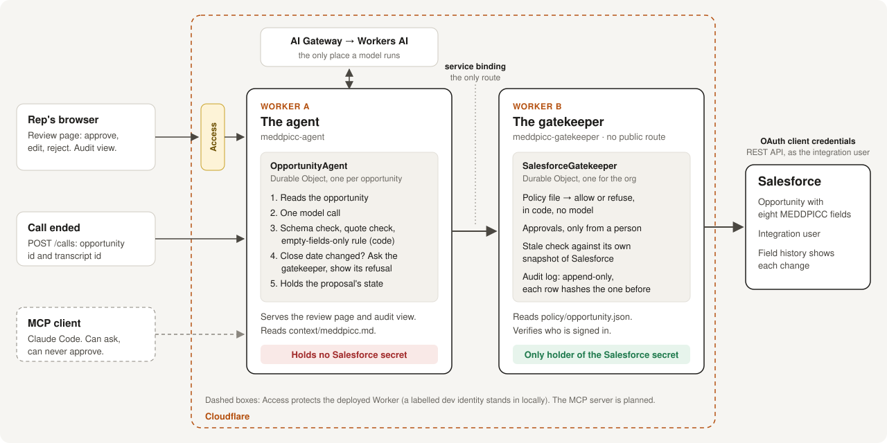
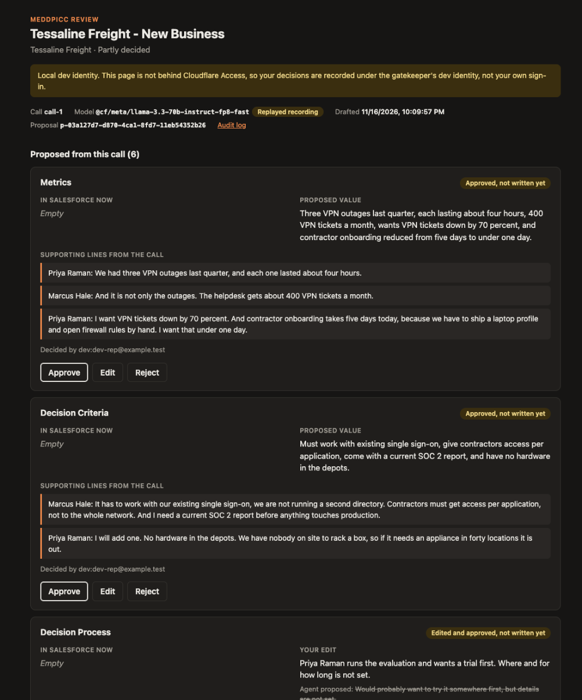
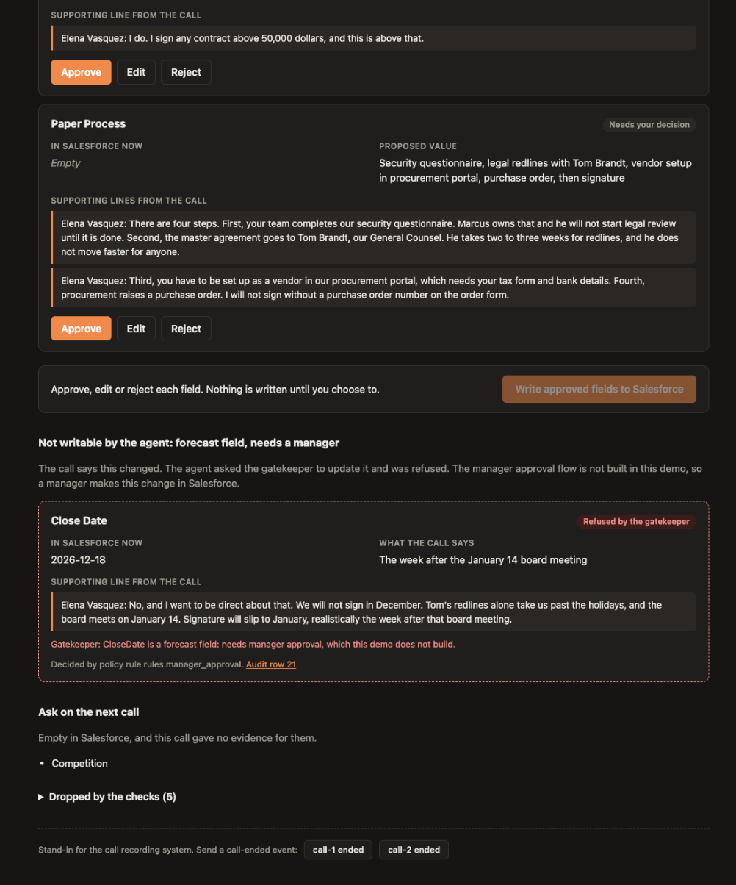
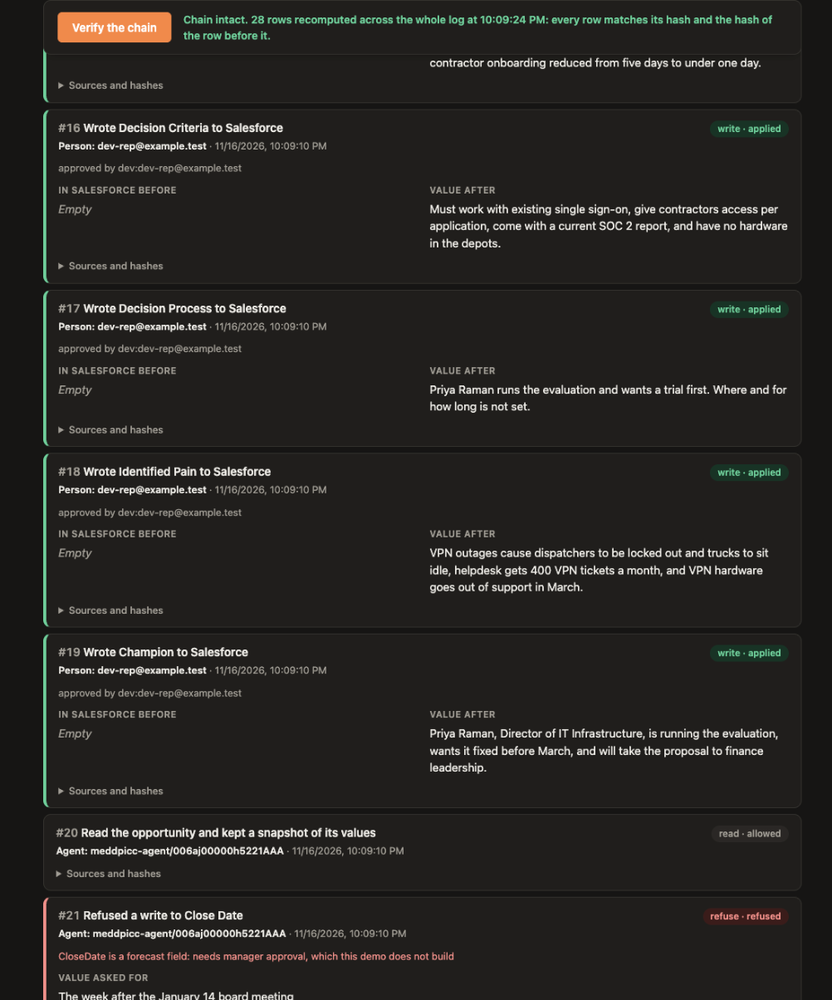

# MEDDPICC from call notes to a governed Salesforce update

A sales call ends. An agent reads the transcript and proposes values for the eight
MEDDPICC fields on the Salesforce opportunity, each with the lines from the call that
support it. The rep approves, edits or rejects each field on one page. A separate
gatekeeper service writes the approved values to Salesforce, refuses anything the policy
does not allow, and keeps an audit log that shows if it has been altered.

Everything runs on Cloudflare: Workers, Durable Objects, Workers AI and AI Gateway.
Salesforce is the only outside system. All data is synthetic: the company, the people and
the calls are invented.



## Status

| Part | State |
| --- | --- |
| Gatekeeper: policy evaluator, approvals, stale check, hash-chained audit log, Salesforce client | Built. 254 tests. |
| Agent: one model call, schema check, quote check, proposal per opportunity | Built. 128 tests. |
| Review page: approve, edit, reject, write approved fields | Built. Runs locally with `npm run dev`. |
| Close date detected in a call and refused by the gatekeeper | Built. Shown on the review page and logged. |
| Audit view with a verify button | Built, at `/audit`. |
| Dedicated Salesforce integration user | Built. Salesforce field history names it on every gatekeeper write. |
| Sign-in with Cloudflare Access | Built, and run end to end on the deployed Worker: a decision made after signing in is recorded under that person's email. Locally a labelled dev identity stands in. |
| MCP server | Built, local only. Four tools at `/mcp`. None can approve. The deployed Worker does not serve it. |
| Deployed | Yes, on the Workers Free plan. The agent Worker's address is behind Cloudflare Access, with a policy that allows one email address. The gatekeeper has no address. |

## What it looks like

The review page after call 1, with four fields approved and one edited. Each proposed
value sits beside what Salesforce holds and the lines from the call behind it.



After call 2. The agent proposes only the two fields that are still empty. The call said
the close date moved, so the agent asked the gatekeeper, and the gatekeeper refused.



The audit view, after "Verify the chain". Every write names the person who approved it,
and the refusal is recorded with the line from the call.



## The parts

- **`workers/agent`** (Worker A). Receives the "call ended" event, drafts the proposal,
  serves the review page. One `OpportunityAgent` Durable Object per opportunity, built on
  the Cloudflare Agents SDK. It has no Salesforce secret.
- **`workers/gatekeeper`** (Worker B). The only holder of the Salesforce credential. One
  `SalesforceGatekeeper` Durable Object holds the approvals, the snapshots used by the
  stale check, and the audit log. It has no public route.
- **`policy/opportunity.json`**. Which fields may be written and on whose approval.
- **`context/meddpicc.md`**. What each MEDDPICC field means and what counts as evidence.
  The model reads it on every call.
- **`fixtures/`**. Two invented call transcripts, hand-written labels for what each call
  should produce, and recorded model answers for tests.
- **`salesforce/`**. The eight custom fields, with field history tracking, and the
  permission set, deployable with the Salesforce CLI. `scripts/sf-integration-user.mjs`
  creates the integration user the gatekeeper runs as.

## Eight questions

### 1. Why is the gatekeeper a separate Worker?

The Salesforce key and secret are bound only to the gatekeeper Worker. The agent Worker,
which reads untrusted transcript text and calls a model, has no Salesforce secret and no
route to Salesforce except a service binding to the gatekeeper. The gatekeeper has no
public URL, so the only way to reach Salesforce is through its typed methods. Every read,
decision, write and refusal passes the policy check and is logged.

### 2. Why can the agent not approve its own proposal?

An approval is a record the gatekeeper stores, and it only stores one from a caller that
proves it is a signed-in person. An agent names itself as an agent, so the gatekeeper
refuses its decision ("only a signed-in person can approve, edit or reject") and logs the
refusal. At write time the gatekeeper checks again that the approval on record is for
this proposal, this field and this exact value.

The same holds for the MCP server. Its four tools act as an agent (`agent:mcp-client`),
and none of them approves, edits, rejects or writes. `request_field_update` only asks the
gatekeeper, which refuses anything with no person's approval behind it.

Deployed, the proof is the signed token Cloudflare Access adds to every request it lets
through. The agent Worker passes the token on, and the gatekeeper verifies it against
Access's public keys: signature, issuer, audience and expiry. The agent Worker can pass a
token on. It cannot make one. A token with no email in it, such as a service token, is
refused, so a script holding a service token cannot approve either.

Locally, the proof is a dev identity, which the gatekeeper accepts only when it is
started with `DEV_IDENTITY` in its local `.dev.vars`. It carries no proof of its own, so
it is a stand-in for local runs and is off in the deployed configuration.

One limit, listed under stubs: the agent Worker sees the person's token, so a compromised
agent Worker could reuse it until it expires.

### 3. Why is the close date treated differently from the MEDDPICC fields?

A MEDDPICC field is the rep's own account of the deal, so the rep can approve it. Close
date, amount, stage and forecast category change the forecast a manager is accountable
for, so the policy file puts them under `manager_approval`, and the gatekeeper refuses
them with "needs manager approval, which this demo does not build".

When a call says the close date has moved, the agent does not propose it. It asks the
gatekeeper to update it, the gatekeeper refuses, and the refusal is shown on the review
page under "Not writable by the agent" and recorded in the audit log with the line from
the call.

The rule has to live in code. Salesforce field permissions cannot make `CloseDate`,
`StageName` or `ForecastCategoryName` read-only for a user who can edit opportunities
(checked in the org: those three are not permissionable). Only `Amount` can be locked
that way, and the permission set does lock it.

### 4. How do you know the agent did not invent a value?

Every proposed value must come with one to three quotes, and code checks that each quote
is in the transcript. Only case and whitespace are forgiven. A quote under 20 characters
is refused, and a quote written as "Speaker: words" must be in a turn by that speaker. A
proposal that fails is dropped before the rep sees it, and the drop is logged with its
reason. If the model's answer does not match the schema, the whole answer is thrown out.

The check proves the quote is real. It does not prove the value follows from the quote.
That is the rep's job, which is why the quote sits beside the value on the review page,
and why `npm run eval` compares live model output with labels written by hand. On the two
fixture calls (2026-11-16) the model agreed with the labels on 15 of 18 answers. All three
differences were the model proposing a value where the label says to leave the field
blank. It missed nothing the labels expected, and no quote failed the check.

### 5. What happens if the rep edits the field in Salesforce while a proposal is waiting?

When the proposal is drafted, the gatekeeper reads the opportunity and keeps its own
snapshot of the values. Before it writes, it reads those fields again. If a field no
longer matches the snapshot, the write for that field is refused as stale, logged, and
shown on the review page with the reason. Other approved fields in the same request are
still written.

To carry on, send the call event again. The new proposal is drafted against the current
values, and because the agent only proposes for empty fields, the field the rep filled in
is now left alone.

### 6. Where does a model run, and where does it deliberately not run?

A model runs in one place: turning the transcript into proposed values with quotes. That
is one Workers AI call (`@cf/meta/llama-3.3-70b-instruct-fp8-fast`) through AI Gateway,
with a JSON schema and temperature 0. The same call also says whether the close date
moved. The model sees the context file and the transcript, and nothing about what
Salesforce holds.

No model runs in the schema check, the quote check, the rule that leaves filled fields
alone, the policy decision, the approval, the stale check, the write, or the audit log
and its verification. Those are ordinary
code, so the same input always gives the same answer and each can be unit tested.

### 7. What would change to run this inside Cloudflare OS?

In Cloudflare OS a Gatekeeper is a Durable Object that implements the platform's
`Gatekeeper` interface and gives agents a typed session API, with credentials in Wrangler
secrets. `SalesforceGatekeeper` would implement that interface, and its three Salesforce
operations (`readOpportunity`, `applyApprovedUpdate`, `requestFieldUpdate`) would become
the session API. The platform's approval queue and user verifier would take the place of
this demo's review page and identity check.

The policy evaluator, the stale check and the audit chain would move as they are. The
context file would become a skill. This mapping comes from reading the `custom-gatekeeper`
package in `cloudflare/cloudflare-os-starter`. The demo has not been run inside Cloudflare OS.

### 8. What is stubbed in this demo, and what would production need?

See the list below. The four largest: there is no manager approval flow, calls come from
fixture files instead of a call recording source, the review surface is a standalone page
instead of Slack or Salesforce, and the agent only proposes for fields that are empty.

## What is stubbed and why

| Stub | What it does today | What production would need |
| --- | --- | --- |
| Manager approval | Forecast fields are always refused and the refusal is logged. | A manager approval flow with its own identity check. |
| Call source | `POST /calls` takes the id of a transcript bundled in the Worker (`call-1`, `call-2`). `npm run call` sends it, and so do two buttons at the foot of the review page. | An event from the call recording system, and transcripts read from it. |
| Review surface | A standalone page served by the agent Worker. | The same decisions made in Slack or inside Salesforce, where reps already work. |
| Person's identity, locally | A labelled dev identity with no proof behind it. The gatekeeper refuses it unless `DEV_IDENTITY` is set in its local `.dev.vars`. | Nothing: it is off when deployed, where a verified Cloudflare Access token is required for every request. |
| MCP server | Local only. The deployed Worker answers 404 on `/mcp`, because an MCP client cannot sign in through Cloudflare Access as a person. | OAuth for MCP clients, as Cloudflare's guide to securing MCP servers describes, with the tools still acting as an agent. |
| Token reuse | The agent Worker passes the person's Access token to the gatekeeper, so a compromised agent Worker could replay that token until it expires. It could not create one. | A decision signed in the browser for one field and one value, or the review page served from a route the agent Worker does not handle. |
| Empty fields only | The agent proposes only for fields that are empty in Salesforce. A proposal for a filled field is dropped in code and the drop is logged, even when the new call adds to it. | Proposing a change to a filled field, shown beside the current value, with a rule for when that is worth a rep's time. |
| Close date value | The agent passes on the new timing in the words of the call ("the week after the January 14 board meeting"). It does not work out a date. | A manager flow that turns the request into a date and approves it. |
| Integration user's email | The integration user exists and holds only the gatekeeper permission set, on the org's one Salesforce Integration licence. Its email address is the admin's. | A mailbox owned by the team that runs the integration. |
| One proposal at a time | A new call replaces the opportunity's current proposal. The old one is kept in the agent's history table but is no longer shown. | A queue of proposals per opportunity. |
| Stale check timing | The check and the write are two Salesforce calls. An edit made between them is not caught. | A conditional update, so Salesforce itself rejects the write if the record changed. |
| Audit log anchoring | The hash chain shows an edited, reordered or deleted row, including rows deleted from the end. Someone able to rewrite the whole table and the stored head could rebuild a consistent chain. | The newest hash published somewhere the gatekeeper cannot write, on a schedule. |
| Policy changes | The policy file is bundled into the gatekeeper at build time. Its hash is in every audit row. | The same, plus review of policy changes before deploy. |
| Text fields only | The eight fields are long text. One opportunity is seeded. | Mapping to whatever field types the org uses. |

## What a model call costs

One live call for one transcript used about 2,600 input tokens and 700 output tokens
(measured on both fixture calls, 2026-11-16). At Workers AI's published rate for this
model that is about 210 Neurons. The free allocation is 10,000 Neurons a day, so about 47
live calls fit in a day, or 23 runs of both calls. It resets at 00:00 UTC.

Replay mode (`npm run dev:replay`) and the test suite use recorded answers and spend
none. The review page says which kind of answer a proposal came from.

## Run it locally

Needs Node 22 or later, a Cloudflare account signed in with `npx wrangler login`, and a
Salesforce Developer Edition org signed in to the Salesforce CLI under the alias
`meddpicc` (`npx sf org login web -a meddpicc`).

In the Salesforce org, create an External Client App by hand, once: Setup > External
Client App Manager > New. Name it `Medpicc_Gatekeeper`. Enable OAuth with the "Manage
user data via APIs (api)" scope and any callback URL, and enable the client credentials
flow. In the app's policies, enable the client credentials flow there too and choose a
Run As user. Copy the consumer key and secret into `workers/gatekeeper/.dev.vars`, using
`.dev.vars.example` as the template. That file is git-ignored.

```sh
npm install
npm run sf:deploy        # the eight fields and the permission set
npm run sf:seed          # one invented account and opportunity
npm run sf:integration-user   # optional: a dedicated user for the gatekeeper to run as
npm test                 # 382 tests, no model calls, no Salesforce calls
npm run dev              # both Workers, at http://localhost:8787, with live model calls
npm run dev:replay       # the same, replaying recorded model answers
npm run call -- call-1   # in a second terminal: the "call ended" event; prints the review and audit links
npm run call -- call-2   # after call 1's fields are written: two more fields, and the close date refused
npm run sf:reset         # blank the eight fields again
npm run check:reset      # with the dev server up: reset then call 1, twice, to prove the Salesforce setup works
npm run mcp:check        # with the dev server up: connect as an MCP client, list the tools, get the close date refused
npm run demo:reset       # with the dev server stopped: blank the fields and clear the local audit log
```

`docs/demo-script.md` has the exact commands and clicks for a three-minute run.

To use the MCP server from Claude Code, start the dev server and open Claude Code in this
folder. `.mcp.json` points it at `http://localhost:8787/mcp`, and Claude Code asks once
whether to trust it.

`npm run eval` runs both fixture calls against the live model and prints, per field,
expected against proposed. `npm run m1:live` shows one allowed write, one refusal and an
intact audit chain against the real org.
